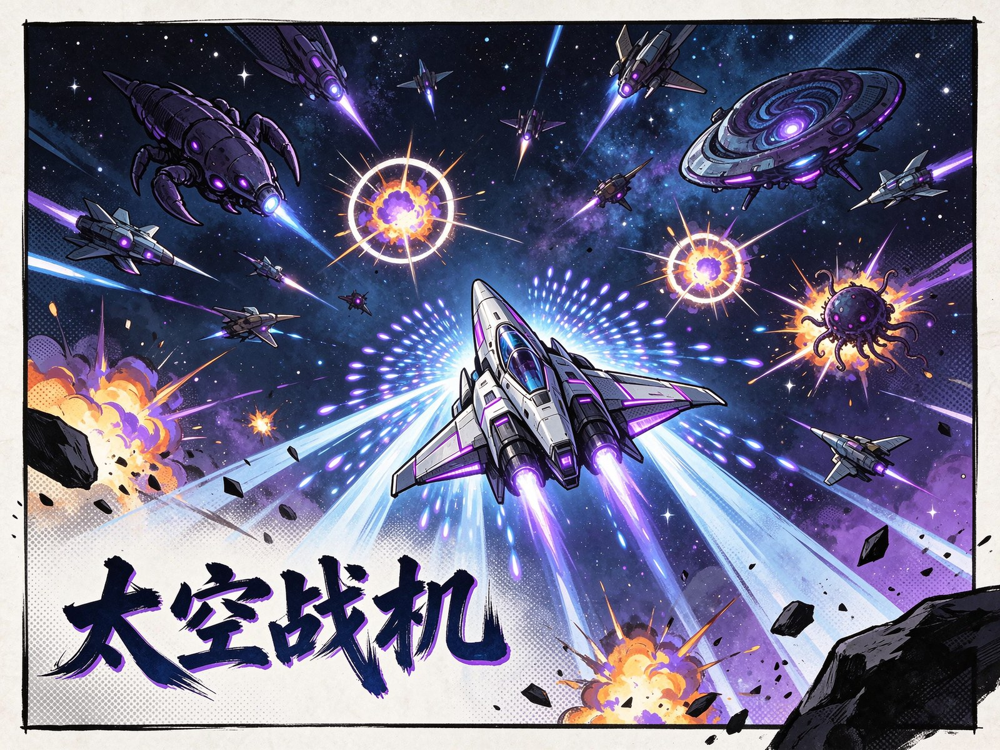

<p align="center"></p>

<h1 align="center">太空战机</h1>

<p align="center">Canvas 太空射击，四种敌机、扇形弹幕、粒子爆炸</p>

<p align="center">
  <a href="http://feiji.aikex.ink/">在线玩</a> ·
  <a href="https://github.com/aiyangdie/feiji">源码仓库</a>
</p>

## 简介

街机手感的太空射击游戏：战机自动三发扇形射击，敌机分四类、各有行为模式，分数越高压力越大。爆炸用 Canvas 光晕叠加 CSS 粒子，两层特效做出层次。

## 功能

- **四种敌机**：直线下落（1 HP）、左右蛇行（2 HP）、逐渐加速（2 HP）、击毁后分裂成两个小敌机（3 HP）
- **扇形自动射击**：三发覆盖，无需手动开火
- **动态难度**：分数越高敌机越多，1000 分后开始反击
- **双层爆炸**：CSS 粒子 + Canvas 光晕
- **音效**：Web Audio 程序化生成射击、爆炸、得分音
- **体验细节**：P 键暂停、失焦自动暂停、首次进入有内置教程、最高分本地保存

## 操作

| 按键 | 功能 |
|---|---|
| W / ↑ | 上移 |
| S / ↓ | 下移 |
| A / ← | 左移 |
| D / → | 右移 |
| 空格 | 开始 / 暂停 / 继续 |
| P | 暂停 / 继续 |
| ESC | 关闭教程 |

死亡后自动重开。

## 快速开始

```bash
git clone https://github.com/aiyangdie/feiji.git
cd feiji
```

直接打开 `index.html`，或用 VSCode Live Server，或 `python -m http.server 8080`。

## 项目结构

```
index.html    主页面（Canvas + 侧边面板）
game.js       主循环、敌机系统、碰撞检测
style.css     版式、粒子动画、分数浮动
io/favicon.ico
```

## 许可证

仓库未附 LICENSE 文件，使用与分发请先联系作者确认。
